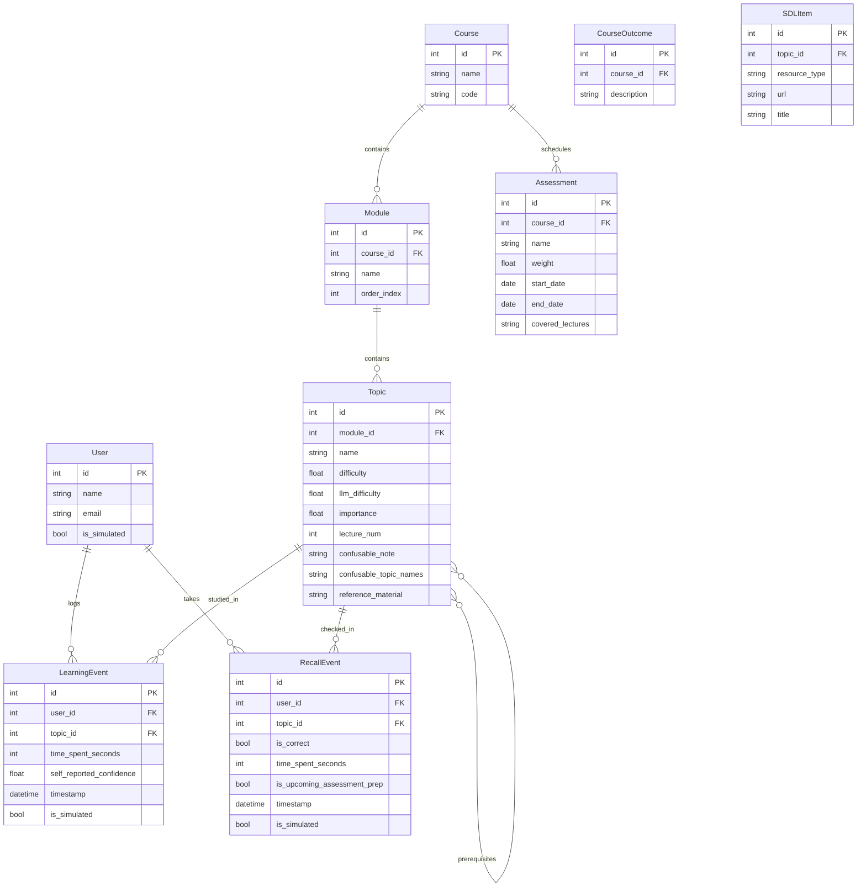
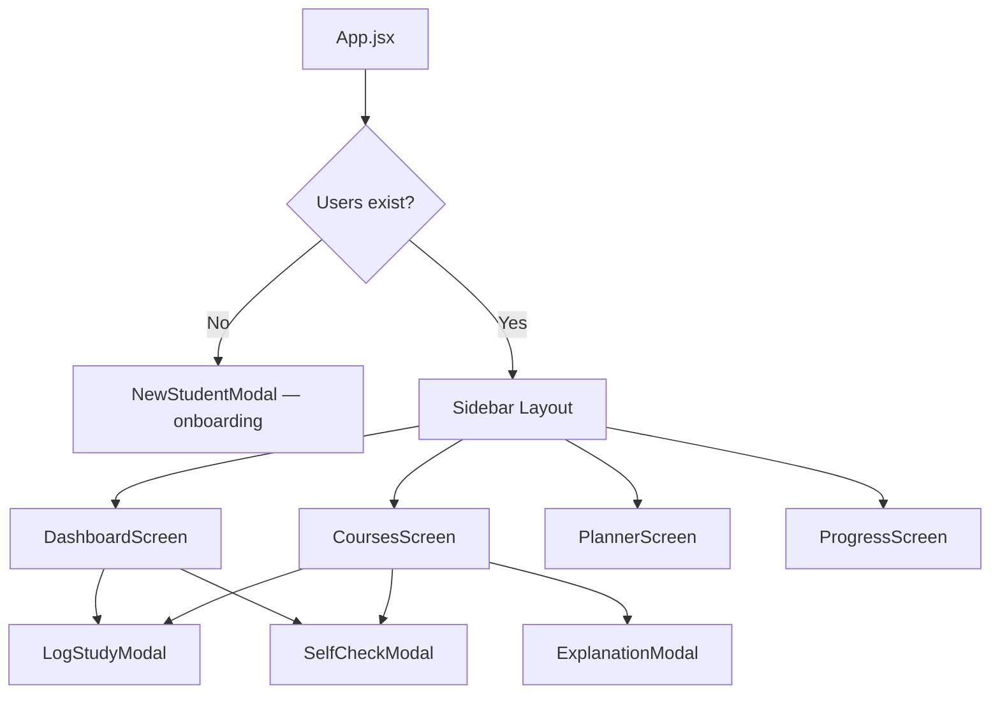

# The Forgetting Engine — Project Report

**Course:** Machine Learning Mini Project (mll-mini)  
**Repository:** [github.com/prishagupta17/MLMiniProject](https://github.com/prishagupta17/MLMiniProject)  
**Branch:** `main` | **Latest Commit:** `c00a698`  
**Report Date:** 3 November 2026

---

## Table of Contents

1. [Executive Summary](#1-executive-summary)
2. [Problem Statement and Motivation](#2-problem-statement-and-motivation)
3. [System Architecture](#3-system-architecture)
4. [ML Pipeline — Step-by-Step](#4-ml-pipeline--step-by-step)
   - [Step 1: Curriculum Seed Loading](#41-step-1-curriculum-seed-loading)
   - [Step 2: Feature Engineering](#42-step-2-feature-engineering)
   - [Step 3: Student Behaviour Simulation](#43-step-3-student-behaviour-simulation)
   - [Step 4: Model Training and Selection](#44-step-4-model-training-and-selection)
   - [Step 4.5: Candidate v2 — Log1p Transform](#45-step-45-candidate-v2--log1p-transform)
   - [Step 4.4: Local Explainability](#46-step-44-local-explainability)
5. [Database Schema](#5-database-schema)
6. [Backend API](#6-backend-api)
7. [Frontend Application](#7-frontend-application)
8. [Model Artifacts](#8-model-artifacts)
9. [Test Suite](#9-test-suite)
10. [Retention Classification Criteria](#10-retention-classification-criteria)
11. [Known Limitations and Future Work](#11-known-limitations-and-future-work)
12. [References](#12-references)
13. [Appendix A — Feature Table](#appendix-a--feature-table)
14. [Appendix B — Simulated Student Behavioural Profiles](#appendix-b--simulated-student-behavioural-profiles)
15. [Appendix C — Commit History](#appendix-c--commit-history)

---

## 1. Executive Summary

**The Forgetting Engine** is a student-facing memory-retention prediction system. It predicts, for each topic a student has studied, how likely they are to have forgotten it by now — and presents that information in a clean, calm dashboard designed to help students prioritise revision without anxiety.

The system is built across three layers:

| Layer | Technology | Purpose |
|-------|-----------|---------|
| ML Model | Scikit-learn Logistic Regression | Predicts per-topic forgetting probability |
| Backend | FastAPI + SQLite + SQLAlchemy | Stores events, serves predictions and explanations |
| Frontend | React + Vite + Tailwind CSS | Student-facing study dashboard and session logger |

The core intellectual contribution is a **zero-leakage, 13-feature forgetting model** grounded in cognitive science (Ebbinghaus forgetting curve, spaced repetition theory) and trained on simulated student data derived from a real seeded curriculum of 4 courses, 21 modules, and 156 topics. A local **log-odds explainability layer** decomposes each prediction into per-feature contributions, allowing students to understand which factors drove their risk score.

---

## 2. Problem Statement and Motivation

Students routinely forget material between study sessions, particularly for technical university courses. The rate of forgetting is non-linear and highly individual, influenced by study frequency, time elapsed, topic difficulty, upcoming assessments, and study load.

> [!NOTE]
> The psychological foundation for this project is the **Ebbinghaus Forgetting Curve** (1885), which demonstrated that retention decays exponentially with time unless reinforced through spaced repetition. Cepeda et al. (2006) extended this with empirical evidence that optimal review intervals depend on the desired retention interval.

Existing tools (e.g., Anki, SuperMemo) focus on generic flashcard memorisation. There are no lightweight, course-aware systems that:
- Use actual syllabus structure (topics, modules, assessments) as model features
- Predict forgetting probability in real-time based on a student's logged study history
- Explain predictions in plain language grounded in the model's mathematics

This project builds exactly that: a course-aware, explainable, student-facing forgetting prediction system.

---

## 3. System Architecture

```
┌─────────────────────────────────────────────────────────┐
│                     FRONTEND (React/Vite)                │
│  Dashboard · My Courses · Study Planner · Progress       │
│  localhost:3000  →  /api proxy  →  backend:8000          │
└──────────────────────────┬──────────────────────────────┘
                           │ HTTP (REST)
┌──────────────────────────▼──────────────────────────────┐
│                  BACKEND (FastAPI)                        │
│  /users  /courses  /modules  /topics                     │
│  /learning-events  /self-check-events                    │
│  /users/{id}/dashboard                                   │
└──────┬──────────────────────────────────────┬───────────┘
       │                                      │
┌──────▼──────────┐              ┌────────────▼──────────┐
│  SQLite DB      │              │  ML Model (.joblib)   │
│  9 ORM tables   │              │  predict.py           │
│  forgetting_    │              │  explainability.py    │
│  engine.db      │              │  features.py          │
└─────────────────┘              └───────────────────────┘
```

**Data flow for a dashboard request:**

1. Frontend calls `GET /users/{id}/dashboard`
2. Backend fetches all `LearningEvent` records for the user
3. For each studied topic, `predict_forgetting()` is called:
   - `compute_current_features()` builds the 13-feature vector from live DB state
   - The `StandardScaler` normalises features
   - The Logistic Regression model returns a forgetting probability
   - `explain_prediction()` decomposes the prediction into log-odds contributions
4. Topics are sorted by descending forgetting probability
5. Dashboard response (retention status, top factors, explanations) is returned as JSON
6. Frontend renders the calm, student-facing view

---

## 4. ML Pipeline — Step-by-Step

### 4.1 Step 1: Curriculum Seed Loading

**Goal:** Populate the database with a real, structured curriculum that the ML features can use as ground truth.

**Seed data source:** Four JSON files under `backend/seed/`, generated by `generate_all_seeds.py` using the `PyPDF2`/`pypdf` library to extract topic lists from official course syllabi.

| Course Code | Course Name | Modules | Topics |
|------------|-------------|---------|--------|
| CSE 3128 | Theory of Computation | 5 | 42 |
| CSE 3129 | Operating Systems | 6 | 38 |
| CSE 3148 | Computer Networks | 5 | 41 |
| HUM 3022 | Technical Communication | 5 | 35 |
| **Total** | | **21** | **156** |

**Seeded metadata per topic:**
- `name` — topic title (from syllabus)
- `lecture_num` — lecture number within the course
- `difficulty` — initial difficulty score (float, 0–1) assigned by LLM enrichment
- `importance` — exam-weight score derived from assessment coverage and course outcome alignment
- `confusable_topic_names` — comma-separated list of related topics likely to be confused
- `prerequisites` — many-to-many topic dependency relationships

**Assessment seeding:**
- 20 assessments seeded across the 4 courses with `start_date`, `end_date`, and `covered_lectures_list`
- These are used by `compute_assessment_timing()` to compute `days_to_next_assessment` and `has_upcoming_assessment` features at prediction time

**Topic importance computation (`compute_topic_importances_for_course`):**

$$\text{importance}_t = \frac{\sum_{a: t \in a} w_a}{N_{\text{assessments in course}}}$$

Where $w_a$ is the assessment's weight (fraction of total marks) and the sum is over all assessments covering topic $t$.

**Seed verification:** 7 acceptance tests in `tests/test_seed_ground_truth.py` assert exact expected counts, unique topic names, and non-null importance and difficulty fields.

---

### 4.2 Step 2: Feature Engineering

**Goal:** Define 13 ML input features with strict zero label-leakage guarantee.

**Leakage rule:** `RecallEvent.is_correct` is the training label (whether the student forgot). It is **never** used as an input feature. All features are computed from `LearningEvent` records and static topic/course metadata only.

**Feature computation context:** Each row in the feature table corresponds to one `RecallEvent`. Features are computed using only data timestamped **at or before** that recall event — strictly enforced in `build_feature_table()`.

#### Feature Definitions

| # | Feature Name | Type | Source | Description |
|---|-------------|------|--------|-------------|
| 1 | `times_studied` | int | LearningEvent | Number of study sessions logged for this topic |
| 2 | `is_first_exposure` | binary | LearningEvent | 1 if this is the first study session, else 0 |
| 3 | `days_since_last_studied` | int | LearningEvent | Days elapsed since the most recent session |
| 4 | `revision_frequency` | float | LearningEvent | `(times_studied - 1) / days_since_first_learned` |
| 5 | `self_reported_confidence` | float [0,1] | LearningEvent | Mean confidence across all prior sessions |
| 6 | `universal_difficulty` | float [0,1] | Topic | Syllabus-seeded difficulty rating |
| 7 | `topic_importance` | float [0,1] | Topic + Assessment | Exam-coverage importance weight |
| 8 | `time_spent_studying_min` | float | LearningEvent | Total minutes studied (sum of all sessions) |
| 9 | `confusability_score` | int | Topic | Count of confusable sibling topics |
| 10 | `prerequisite_completion_ratio` | float [0,1] | LearningEvent | Fraction of prerequisite topics studied |
| 11 | `concurrent_topic_load` | int | LearningEvent | Distinct other topics studied in the past 7 days |
| 12 | `days_to_next_assessment` | int [0,60] | Assessment | Days until next covering assessment (capped at 60) |
| 13 | `has_upcoming_assessment` | binary | Assessment | 1 if an upcoming assessment covers this topic |

**6 acceptance tests** in `tests/test_step2_features.py` verify: correct column count, no leakage from `is_correct`, correct concurrent window calculation, assessment timing edge cases, prerequisite ratio correctness, and confusability score extraction.

---

### 4.3 Step 3: Student Behaviour Simulation

**Goal:** Generate a labelled training dataset (feature vectors + `forgot` labels) since no real historical data existed at project inception.

**Design principles:**
- All simulated records are flagged with `is_simulated=True` on `User`, `LearningEvent`, and `RecallEvent`
- Topics come exclusively from the seeded curriculum — no invented topics
- `RecallEvent.is_correct` is derived from a documented forgetting model (exponential decay), never fed back as an input feature
- Reproducible: identical `SimulationConfig` → identical output via fixed random seed

**Simulation parameters:**

| Parameter | Value |
|-----------|-------|
| Number of students | 30 |
| Random seed | 42 |
| Semester start | 2026-08-01 |
| Semester end | 2026-11-30 |
| Calendar jitter per student | ±14 days uniform |

**Behavioural profiles (6 archetypes):**

| Profile | Topic Coverage | Sessions/Topic | Study Interval | Forgetting Factor | Weight |
|---------|---------------|----------------|----------------|-------------------|--------|
| Consistent | 55–80% | 3–7 | 3–8 days | 0.80 | 20% |
| Crammer | 50–75% | 2–5 | 1–3 days | 0.95 | 20% |
| Struggling | 30–55% | 1–3 | 7–14 days | 1.20 | 15% |
| Overloaded | 40–65% | 2–4 | 4–10 days | 1.10 | 20% |
| Motivated | 65–90% | 4–8 | 2–6 days | 0.70 | 15% |
| Passive | 20–45% | 1–2 | 10–21 days | 1.30 | 10% |

**14 acceptance tests** in `tests/test_step3_simulation.py` verify: correct student count, profile distribution, no data contamination from real students, calendar offset bounds, and label derivation correctness.

---

### 4.4 Step 4: Model Training and Selection

**Goal:** Train and select the best binary classifier for `forgot ∈ {0, 1}`.

**Training data:** Feature table built from 30 simulated students × their study histories across 156 topics.

**Train/test split:** Random 80/20 stratified split (`test_size=0.2, stratify=y, random_state=42`).

**Preprocessing:** `StandardScaler` — zero mean, unit variance on all 13 features. Fit on training set only; transform applied to test set.

**Candidate models:**

| Model | Class Weight | Key Hyperparameters |
|-------|-------------|---------------------|
| Logistic Regression | balanced | `max_iter=1000` |
| Random Forest | balanced | `n_estimators=200, max_depth=6` |

**Selection criterion:** ROC-AUC. Logistic Regression was selected as the production model.

**Production model (v1) — top feature coefficients (standardised):**

| Feature | Coefficient |
|---------|------------|
| `times_studied` | −0.4527 (more study → lower risk) |
| `days_since_last_studied` | +0.4283 (longer gap → higher risk) |
| `time_spent_studying_min` | +0.1568 |
| `concurrent_topic_load` | −0.0409 |
| `has_upcoming_assessment` | +0.0378 |

> [!NOTE]
> Positive coefficients push forgetting probability upward; negative coefficients reduce it. The model is trained on **standardised** features, so coefficient magnitudes are directly comparable across features.

**Saved artifact:** `backend/models/forgetting_model.joblib`
**Bundle keys:** `model`, `model_name`, `scaler`, `feature_columns`, `importances`

---

### 4.5 Step 4.5: Candidate v2 — Log1p Transform

**Goal:** Address potential coefficient explosion at large `days_since_last_studied` values by applying a `log1p` transform.

**Motivation:** In the raw feature space, `days_since_last_studied` can grow unboundedly (e.g., a student who studied a topic once months ago). The log1p transform compresses this range while preserving monotonicity and being exactly invertible.

**Changes from v1:**
- **Feature transform:** `days_since_last_studied` → `log1p(days_since_last_studied)` before scaling
- **Split strategy:** Student-Grouped split (`GroupShuffleSplit`, `n_splits=1, test_size=0.20`) — 24 training students, 6 held-out test students
- **Bundle schema version:** `schema_version=2`, `model_version="2.0.0"`
- **Raw feature means stored:** `raw_feature_means` dict for correct explainability baselines

**v2 Evaluation Metrics:**

| Metric | Value |
|--------|-------|
| ROC-AUC | 0.6820 |
| Brier Score | 0.2409 |
| Log Loss | 0.6741 |
| Accuracy | 0.5699 |
| Recall | 0.7452 |
| Precision | 0.3509 |
| F1 | 0.4771 |

> [!IMPORTANT]
> v2 is an **experimental candidate only**. The production system uses v1 (`forgetting_model.joblib`). Both artifacts are frozen and no further retraining is planned.

**Saved artifact:** `backend/models/forgetting_model_v2.joblib`

---

### 4.6 Step 4.4: Local Explainability

**Goal:** Produce per-topic, per-student, mathematically exact explanations for each forgetting probability prediction.

**Method:** Log-odds decomposition of the Logistic Regression model.

**Mathematical identity:**

For a Logistic Regression model with coefficients $\beta_i$, intercept $b$, and scaled features $\tilde{x}_i$:

$$z = b + \sum_{i=1}^{13} \beta_i \tilde{x}_i \quad \text{(predicted log-odds)}$$

$$P(\text{forgot}) = \sigma(z) = \frac{1}{1 + e^{-z}}$$

The contribution of feature $i$ is:

$$c_i = \beta_i \cdot \tilde{x}_i$$

This decomposition satisfies the **exact identity**:

$$b + \sum_{i=1}^{13} c_i = z = \log\!\left(\frac{P}{1-P}\right)$$

**Implementation:** `backend/app/explainability.py`

**Key design decisions:**
1. **Contributions are in log-odds space**, not percentage-point space — mathematically exact, not approximate
2. **Raw feature values are shown to students** — log-transformed internals are never exposed
3. **Non-causal language** — "This feature contributes positively to the model's risk score" rather than "This causes forgetting"
4. **Training baseline comparison** — each explanation compares the student's value to the training cohort mean (`PROD_FEATURE_MEANS`)
5. **Top 3 + 3** — three largest positive contributors and three largest negative contributors are surfaced

**Output structure per topic:**

```json
{
  "intercept": -0.312,
  "predicted_log_odds": 0.187,
  "reconstructed_probability": 0.547,
  "positive_factors": [...],
  "negative_factors": [...],
  "top_factors": [...],
  "all_factors": [...]
}
```

---

## 5. Database Schema

**Database engine:** SQLite via SQLAlchemy ORM  
**File:** `backend/forgetting_engine.db`



**Current database state (live, no simulated data):**

| Table | Record Count |
|-------|-------------|
| Users | 1 real student |
| Courses | 4 |
| Modules | 21 |
| Topics | 156 |
| Assessments | 20 |
| LearningEvents | real data only |
| RecallEvents | real data only |

---

## 6. Backend API

**Framework:** FastAPI 0.100+  
**Base URL:** `http://127.0.0.1:8000`  
**CORS:** Open (`allow_origins=["*"]`) — for development only  
**Database session:** Dependency-injected via `get_db()`

### Endpoints

#### Users

| Method | Path | Description |
|--------|------|-------------|
| `GET` | `/users` | List all users |
| `POST` | `/users` | Create a new user (idempotent on email) |

**`POST /users` body:**
```json
{ "name": "Nandini", "email": "student@example.com" }
```

**Response `UserOut`:**
```json
{ "id": 1, "name": "Nandini", "email": "student@example.com" }
```

---

#### Courses, Modules, Topics

| Method | Path | Description |
|--------|------|-------------|
| `GET` | `/courses` | List all 4 courses |
| `GET` | `/courses/{course_id}/modules` | List modules in a course |
| `GET` | `/modules/{module_id}/topics` | List topics in a module |

**`GET /courses` response `CourseOut[]`:**
```json
[{ "id": 1, "name": "Theory of Computation", "code": "CSE 3128" }]
```

---

#### Study Events

| Method | Path | Description |
|--------|------|-------------|
| `POST` | `/learning-events` | Log a study session |
| `POST` | `/self-check-events` | Log a recall self-check |

**`POST /learning-events` body:**
```json
{
  "user_id": 1,
  "topic_id": 5,
  "time_spent_seconds": 2700,
  "self_reported_confidence": 0.85
}
```

**`POST /self-check-events` body:**
```json
{
  "user_id": 1,
  "topic_id": 5,
  "is_correct": true,
  "time_spent_seconds": 60,
  "is_upcoming_assessment_prep": false
}
```

> [!IMPORTANT]
> `POST /self-check-events` also calls `refresh_topic_difficulty()` after logging, updating the topic's crowd-sourced difficulty score based on the current recall accuracy across all users. The updated difficulty is returned in the response. This recall result is **never fed back into the forgetting model as an input feature**.

---

#### Dashboard

| Method | Path | Description |
|--------|------|-------------|
| `GET` | `/users/{user_id}/dashboard` | Full retention dashboard for a student |

**Response `DashboardOut`:**
```json
{
  "user_id": 1,
  "generated_at": "2026-11-03T14:00:00Z",
  "overall_retention_score": 0.46,
  "high_risk_count": 0,
  "topics": [
    {
      "topic_id": 2,
      "topic_name": "Grammar and Automata",
      "module_name": "Module CO1",
      "forgetting_probability": 0.54,
      "retention_status": "moderate_risk",
      "top_factors": [...],
      "local_explanation": { ... }
    }
  ]
}
```

Topics are sorted by descending `forgetting_probability`.  
`overall_retention_score = 1 − mean(forgetting_probabilities)`.

---

## 7. Frontend Application

**Framework:** React 18 + Vite 5  
**Styling:** Tailwind CSS v3  
**Font:** Plus Jakarta Sans (Google Fonts)  
**Dev server:** `localhost:3000` (Vite proxy: `/api/*` → `http://127.0.0.1:8000/*`)

### Screen Map



### Screens

#### Dashboard Screen (`DashboardScreen.jsx`)

- Greeting with student name and email
- **Retention summary cards:** Topics remembered / Review soon / Needs refresher
- **Focus topic card:** Highest-risk studied topic with exact forgetting probability
- **Up-next list:** Next 3 topics by risk, with retention badges
- **Empty state:** Call-to-action when no study sessions have been logged
- Refreshes automatically after logging a study event or self-check

#### My Courses Screen (`CoursesScreen.jsx`)

- Four course tabs (one per course)
- Module accordion — collapsed by default, expands on click
- Topic rows with:
  - Retention badge (exact percentage, e.g. "Review Soon (54%)")
  - "Not studied yet" badge for unstudied topics
  - Study and Quiz buttons to open modals
- Filter pills: All / Due / Remembered
- Retention criteria explainer banner

#### Study Planner Screen (`PlannerScreen.jsx`)

- **Immediate Priority section:** Topics in `high_risk` (≥ 60% forgetting probability)
- **Secondary Priority section:** Topics in `moderate_risk` (35–60%)
- Cards show topic name, course, exact risk percentage, and quick action buttons
- Empty state when all topics are well-retained

#### Progress Screen (`ProgressScreen.jsx`)

- Retention distribution stacked bar (Remembered / Review Soon / Needs Refresher)
- Course health cards showing per-course retention averages

### Components

| Component | Purpose |
|-----------|---------|
| `Sidebar.jsx` | Fixed left navigation (Dashboard, My Courses, Study Planner, Progress) |
| `Navbar.jsx` | Top bar with student selector, Log Study, Self-Check, and Add Student actions |
| `LogStudyModal.jsx` | Study session form (duration slider, confidence slider); persists inputs to `localStorage` per user+topic |
| `SelfCheckModal.jsx` | Recall quiz (Correct/Incorrect radio); posts to `/self-check-events` |
| `ExplanationModal.jsx` | ML explanation display with friendly text; collapsible log-odds math details |
| `NewStudentModal.jsx` | Onboarding form for creating a new student profile |
| `api.js` | Centralised API client — all `fetch()` calls through Vite proxy |

### State Management

All state lives in `App.jsx`. Key state variables:

| State | Description |
|-------|-------------|
| `users` | All students fetched from `GET /users` |
| `selectedUser` | Currently active student |
| `dashboardData` | Cached dashboard response for the selected student |
| `courses` | Course list from `GET /courses` |
| `lastActiveTopicId` | Tracks which topic was last interacted with (restores modal context) |

**localStorage persistence:**  
Study modal saves `study_session_{userId}_{topicId}` = `{ minutes, confidence }` to `localStorage`, so inputs persist when a student reopens the modal.

### Design System

| Token | Value |
|-------|-------|
| Primary accent | `#6C5CE7` (purple) |
| Success / Remembered | `#00B894` (green) |
| Warning / Review soon | `#FDCB6E` (amber) |
| Danger / Needs refresher | `#E17055` (coral) |
| Background | `#F8F7FF` (light lavender) |
| Card surface | `#FFFFFF` |
| Border radius | `rounded-xl` (12px) |
| Font | Plus Jakarta Sans |

---

## 8. Model Artifacts

All artifacts are in `backend/models/` and are frozen — no further retraining.

| File | Role | SHA-256 (first 16 hex) | Schema Version |
|------|------|-----------------------|----------------|
| `forgetting_model.joblib` | **Production (v1)** | `4F0862C7D7FB33AC` | 1 (implicit) |
| `forgetting_model_v2.joblib` | Experimental candidate (v2) | `03E89030D3F79526` | 2 |
| `forgetting_model_legacy_11feat.joblib` | Legacy backup (11 features) | `F6C3A9D6...` | — |

**v1 bundle keys:**

```python
{
  "model":           LogisticRegression(...),
  "model_name":      "logistic_regression",
  "scaler":          StandardScaler(...),
  "feature_columns": [...],   # 13 features
  "importances":     {...},   # sorted by abs(coefficient)
}
```

**v2 bundle keys (additional):**

```python
{
  "model_version":       "2.0.0",
  "schema_version":      2,
  "feature_transforms":  {"days_since_last_studied": "log1p"},
  "raw_feature_means":   {...},
  "training_metadata":   {
      "split_strategy": "Student-Grouped (24 train, 6 test)",
      "metrics": { "roc_auc": 0.6820, "recall": 0.7452, ... }
  }
}
```

---

## 9. Test Suite

**Total tests:** 53 | **Status:** All passing

| File | Tests | Scope |
|------|-------|-------|
| `test_seed_ground_truth.py` | 7 | Course/module/topic counts, non-null seeded fields |
| `test_seed_loader.py` | 4 | Seed loader idempotency and data integrity |
| `test_step2_features.py` | 6 | Feature column count, zero leakage, concurrent window, assessment timing |
| `test_step3_simulation.py` | 14 | Student count, profile distribution, no real-data contamination |
| `test_step4_explanations.py` | 13 | Log-odds identity, explanation structure, non-causal language |
| `test_model_v2.py` | 9 | v2 schema validation, log1p transform, GroupShuffleSplit, metric bounds |

**Test isolation strategy:**
- All simulation tests use an **in-memory SQLite database** — the live database is never touched
- `test_step4_explanations.py` and `test_model_v2.py` use `_get_or_create_test_student()` / `_ensure_v2_test_user()` helpers that create a minimal test user (email ending `@test.internal`) only when the database is empty, and reuse existing users otherwise

**Run all tests:**
```bash
cd backend
python -m pytest ../tests/ -v
```

---

## 10. Retention Classification Criteria

The forgetting probability output by the model is classified into three human-readable retention states:

| Status | Condition | Display Label | Colour |
|--------|-----------|--------------|--------|
| `low_risk` | P < 35% | ✅ Remembered | Green |
| `moderate_risk` | 35% ≤ P < 60% | 🟡 Review Soon | Amber |
| `high_risk` | P ≥ 60% | 🔴 Needs Refresher | Coral |

These thresholds are set in `backend/app/predict.py` and applied consistently across the dashboard API, the Study Planner, and the My Courses screen retention badges.

> [!NOTE]
> The thresholds are pragmatic choices, not derived from a particular psychological model. A topic at 34% risk is "remembered" but the probability is non-negligible. Students should use these as guidance, not certainties.

---

## 11. Known Limitations and Future Work

### Current Limitations

| Area | Limitation |
|------|-----------|
| **Training data** | Model trained entirely on simulated data. Real student histories may have different statistical distributions. |
| **Calibration** | No Platt scaling or isotonic regression — predicted probabilities are not formally calibrated. |
| **Label source** | `RecallEvent.is_correct` from self-checks is the only label source, which is subject to self-report bias. |
| **Single model** | Production uses a single global Logistic Regression. No personalisation or student-specific adaptation. |
| **Authentication** | No authentication system — student selection via dropdown only. |
| **Concurrent load metric** | `concurrent_topic_load` computed over a fixed 7-day window; window size not cross-validated. |
| **Topic importance** | Computed once at seed time; does not update if assessment schedules change. |
| **Mobile layout** | Responsive but not fully optimised for small screens. |

### Future Work

1. **Calibration:** Apply Platt scaling or isotonic regression to produce calibrated probability estimates
2. **Online learning:** Update model coefficients incrementally as real recall events accumulate
3. **Personalisation:** Bayesian hierarchical model with student-level random effects
4. **Authentication:** Add proper user authentication (OAuth2 / JWT)
5. **Spaced repetition scheduling:** Generate review schedule recommendations using SM-2 or FSRS algorithm
6. **Assessment integration:** Connect to a real LMS for automated assessment schedule updates
7. **Difficulty refinement:** Expand `refresh_topic_difficulty()` beyond simple accuracy ratios
8. **Deployment:** Containerise with Docker; add a production WSGI server (Uvicorn + Gunicorn)

---

## 12. References

### Cognitive Science and Spaced Repetition

1. **Ebbinghaus, H.** (1885). *Über das Gedächtnis: Untersuchungen zur experimentellen Psychologie*. Duncker & Humblot. *(The foundational forgetting curve study)*

2. **Cepeda, N. J., Pashler, H., Vul, E., Wixted, J. T., & Rohrer, D.** (2006). Distributed practice in verbal recall tasks: A review and quantitative synthesis. *Psychological Bulletin*, 132(3), 354–380. https://doi.org/10.1037/0033-2909.132.3.354

3. **Wozniak, P. A., & Gorzelanczyk, E. J.** (1994). Optimization of repetition spacing in the practice of learning. *Acta Neurobiologiae Experimentalis*, 54, 59–62. *(SuperMemo SM-2 algorithm)*

4. **Kornell, N., & Bjork, R. A.** (2008). Optimising self-regulated study: The benefits — and costs — of dropping flashcards. *Memory*, 16(2), 125–136.

### Machine Learning

5. **Pedregosa, F., et al.** (2011). Scikit-learn: Machine learning in Python. *Journal of Machine Learning Research*, 12, 2825–2830. https://scikit-learn.org/

6. **Hosmer, D. W., Lemeshow, S., & Sturdivant, R. X.** (2013). *Applied Logistic Regression* (3rd ed.). Wiley.

7. **Brier, G. W.** (1950). Verification of forecasts expressed in terms of probability. *Monthly Weather Review*, 78(1), 1–3. *(Brier score for probabilistic calibration)*

### Software and Frameworks

8. **FastAPI** — Ramírez, S. (2018–). https://fastapi.tiangolo.com/

9. **SQLAlchemy** — Bayer, M. (2006–). https://www.sqlalchemy.org/

10. **Joblib** — Varoquaux, G., et al. https://joblib.readthedocs.io/

11. **React** — Meta Platforms. https://react.dev/

12. **Vite** — Evan You et al. https://vitejs.dev/

13. **Tailwind CSS** — Wathan, A. https://tailwindcss.com/

14. **NumPy** — Harris, C. R., et al. (2020). Array programming with NumPy. *Nature*, 585, 357–362.

15. **Pandas** — McKinney, W. (2010). Data structures for statistical computing in Python. *Proceedings of the 9th Python in Science Conference*, 56–61.

---

## Appendix A — Feature Table

Full feature definitions with data types, sources, valid ranges, and training baseline means.

| Feature | Type | Source | Valid Range | Training Mean (v1) |
|---------|------|--------|------------|-------------------|
| `times_studied` | int | LearningEvent | ≥ 1 | 6.11 |
| `is_first_exposure` | binary | LearningEvent | {0, 1} | 0.00 |
| `days_since_last_studied` | int | LearningEvent | ≥ 0 | 2.67 |
| `revision_frequency` | float | LearningEvent | ≥ 0 | 0.18 |
| `self_reported_confidence` | float | LearningEvent | [0, 1] | 0.55 |
| `universal_difficulty` | float | Topic (seed) | [0, 1] | 0.50 |
| `topic_importance` | float | Topic + Assessment | [0, 1] | 0.81 |
| `time_spent_studying_min` | float | LearningEvent | ≥ 0 | 235.56 |
| `confusability_score` | int | Topic (seed) | ≥ 0 | 0.00 |
| `prerequisite_completion_ratio` | float | LearningEvent | [0, 1] | 1.00 |
| `concurrent_topic_load` | int | LearningEvent (7d) | ≥ 0 | 44.21 |
| `days_to_next_assessment` | int | Assessment | [0, 60] | 17.06 |
| `has_upcoming_assessment` | binary | Assessment | {0, 1} | 0.85 |

> [!NOTE]
> Training means are from the production v1 model's `StandardScaler.mean_` attribute, reflecting the simulated cohort of 30 students across the 2026 semester.

---

## Appendix B — Simulated Student Behavioural Profiles

Full profile parameter table used in `synthetic_data.py`.

| Parameter | Consistent | Crammer | Struggling | Overloaded | Motivated | Passive |
|-----------|-----------|---------|-----------|-----------|----------|--------|
| Topic coverage | 55–80% | 50–75% | 30–55% | 40–65% | 65–90% | 20–45% |
| Sessions/topic | 3–7 | 2–5 | 1–3 | 2–4 | 4–8 | 1–2 |
| Study interval (days) | 3–8 | 1–3 | 7–14 | 4–10 | 2–6 | 10–21 |
| Session duration (min) | 15–40 | 20–60 | 10–25 | 15–35 | 25–60 | 5–15 |
| Confidence bias | +0.10 | +0.05 | −0.15 | −0.05 | +0.20 | −0.20 |
| Forgetting factor | 0.80 | 0.95 | 1.20 | 1.10 | 0.70 | 1.30 |
| Pre-assessment boost sessions | 1 | 3 | 0 | 1 | 2 | 0 |
| Cohort weight | 20% | 20% | 15% | 20% | 15% | 10% |

---

## Appendix C — Commit History

Full chronological commit log for the `main` branch.

| Commit | Message |
|--------|---------|
| `c00a698` | `fix(ui): remove 'Why this' and 'Why' explanation buttons across all screens` |
| `0194d73` | `fix(ui): persist study inputs per topic, display exact retention percentages, and retain active topic context` |
| `e1ea08f` | `feat(app): purge simulated student data, enable real student onboarding and direct study logging` |
| `676d8b5` | `style(ui): simplify dashboard to calm, student-first focus view with progressive disclosure` |
| `da5c54e` | `feat(ui): implement student-facing React Vite dashboard with explainability and study tracking` |
| `9542658` | `feat(model): implement Model 6 candidate v2 with log1p transform and explainability` |
| `feaf888` | `feat(explain): refine student-facing explanations to neutral contribution descriptions` |
| `2971c61` | `feat(explain): contextualize feature baselines and improve student-facing explanations` |
| `4b8852b` | `feat(explain): add topic-specific forgetting risk explanations` |
| `189a869` | `fix(tests): resolve pypdf runtime dependency and isolate legacy model test with tmp fixture` |
| `d09d932` | `feat(sim): Step 3 simulated student data with profiles, calendar shifts, and acceptance tests` |
| `d0f7046` | `feat(features): Step 2 completed with 13 features, zero leakage, and acceptance tests` |
| `a5718d3` | `feat(seed): Step 1 verified with ground truth acceptance tests` |
